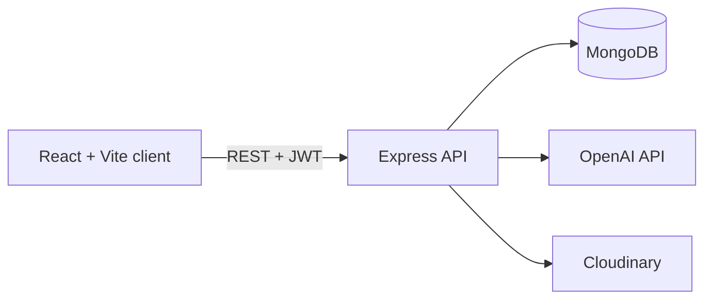

# FIT-ARC-GYM

An AI-powered fitness platform (MERN) with personalized workouts, diet tracking, an AI coach, and a **transaction-safe internal wallet** for buying subscription plans.

[](https://github.com/lenin-12/Fit-Arc-Gym/actions/workflows/ci.yml)

**Live demo:** (https://fit-arc-gym.vercel.app/)
**Screenshots:** 


---

## Highlights

- **Wallet payments with ACID guarantees.** Plan checkout debits a user wallet and credits a platform wallet inside a single MongoDB session transaction, so a failure midway rolls everything back.
- **Idempotent payments.** Every payment request carries an idempotency key. A retried request (for example after a network timeout) never charges twice.
- **Server-side pricing.** The payable amount (plan price, 18% GST, and upgrade credit) is always calculated on the server, never trusted from the client.
- **AI coach and workout generation** using the OpenAI API, with streamed responses and saved chat history.
- **Tested and automated.** Unit, API, and wallet tests run on every pull request through GitHub Actions.

---

## Tech Stack

| Layer    | Technologies |
|----------|--------------|
| Frontend | React 18, Vite, React Router, Framer Motion, GSAP |
| Backend  | Node.js, Express, Mongoose |
| Database | MongoDB (replica set required for transactions) |
| Auth     | JWT, bcrypt |
| AI       | OpenAI API |
| Storage  | Cloudinary (profile pictures), Multer |
| DevOps   | GitHub Actions (CI), Vercel (frontend) |

---

## Wallet and Payments Design

The most involved part of the backend is the wallet system (`backend/controllers/walletController.js`, `backend/utils/planUtils.js`).

**Checkout flow**

1. The client asks for a quote (`GET /api/payments/quote`). The server computes plan price + GST and subtracts any upgrade credit.
2. The client submits the purchase (`POST /api/payments/plan`) with an idempotency key.
3. The server opens a Mongoose session transaction and:
   - checks the idempotency record (a repeated key returns the original result),
   - debits the user wallet,
   - credits the platform wallet,
   - writes the wallet transaction and updates the user's plan,
   - commits, or aborts everything on any error.

**Plan rules** (`calculateAuthoritativePayable`)

| Situation | Result |
|-----------|--------|
| No active plan | Full price + 18% GST |
| Upgrade to a higher tier while active | Pay the difference (current plan price is credited) |
| Same tier while still active | Rejected (`ALREADY_ON_PLAN`) |
| Downgrade while active | Rejected (`DOWNGRADE_NOT_ALLOWED`) |

**Tested scenarios** include concurrent overspend attempts, idempotent retries after a timeout, mid-transaction rollback with no leaked balance, and duplicate registration bonuses (14 scenarios in `npm run test:wallet`).

---

## Architecture



```
Fit-Arc-Gym/
├── frontend/                # React + Vite client
│   └── src/ (pages, components, context, hooks, services)
├── backend/                 # Express API
│   ├── controllers/         # Request handlers (auth, wallet, plan, AI, ...)
│   ├── models/              # Mongoose models (User, Wallet, Payment, ...)
│   ├── routes/              # API route definitions
│   ├── middlewares/         # Auth and request guards
│   ├── services/            # OpenAI, workout, nutrition logic
│   ├── validators/          # Input validation
│   ├── utils/               # Plan pricing and helpers
│   ├── scripts/             # Wallet migration script
│   └── tests/               # Unit, API, and wallet tests
├── deploy/                  # Deployment configs (nginx, PM2, scripts)
└── .github/workflows/       # CI pipeline
```

---

## API Overview

| Area | Endpoints |
|------|-----------|
| Auth | `POST /api/auth/register`, `POST /api/auth/login`, `GET /api/auth/me` |
| User | `PUT /api/user/profile`, `POST /api/user/upload-avatar`, `POST /api/user/change-password` |
| Workout | `GET /api/workout/today`, `PATCH /api/workout/exercise`, `POST /api/workout/finish` |
| Nutrition | `GET /api/nutrition/today`, `POST /api/nutrition/meal` |
| AI | `POST /api/ai/coach`, `POST /api/ai/coach-stream`, `POST /api/ai/generate-workout` |
| Plans | `GET /api/plan`, `GET /api/plan/status`, `POST /api/plan/select` |
| Wallet | `GET /api/wallet`, `GET /api/wallet/transactions`, `GET /api/payments/quote`, `POST /api/payments/plan` |
| Admin | `GET /api/admin/wallet`, `GET /api/admin/transactions` |
| Health | `GET /api/health`, `GET /api/health/db` |

Protected routes need an `Authorization: Bearer <token>` header.

---

## Getting Started

### Prerequisites

- Node.js 22+
- MongoDB running as a **replica set** (needed for transactions). A free MongoDB Atlas cluster works, or run a local single-node replica set.
- An OpenAI API key and a Cloudinary account (for AI features and image uploads)

### 1. Clone

```bash
git clone https://github.com/lenin-12/Fit-Arc-Gym.git
cd Fit-Arc-Gym
```

### 2. Backend

```bash
cd backend
cp .env.example .env      # then fill in the values below
npm install
npm run dev               # http://localhost:5001
```

| Variable | Purpose |
|----------|---------|
| `PORT`, `HOST`, `NODE_ENV` | Server settings |
| `CORS_ORIGIN` | Allowed frontend origin |
| `MONGO_URI` | MongoDB connection string |
| `JWT_SECRET`, `JWT_EXPIRES_IN` | Auth token signing and expiry |
| `OPENAI_API_KEY`, `OPENAI_MODEL` | AI coach and workout generation |
| `CLOUDINARY_CLOUD_NAME`, `CLOUDINARY_API_KEY`, `CLOUDINARY_API_SECRET` | Image uploads |

If you already have wallet data from an older version, run `npm run migrate:wallet` once.

### 3. Frontend

```bash
cd frontend
cp .env.example .env
npm install
npm run dev               # http://localhost:5173
```

---

## Testing

```bash
cd backend
npm run test:unit         # pricing and plan logic
npm run test:wallet       # 14 wallet scenarios (concurrency, idempotency, rollback)
npm test                  # unit + API tests
```

GitHub Actions (`.github/workflows/ci.yml`) runs the backend tests and a frontend production build on every pull request and every push to `main`.

---

## Deployment

- **Frontend:** deployed on Vercel through its GitHub integration.
- **Backend:** deployment configs for AWS (EC2, S3, CloudFront) are included under `deploy/` and `.github/workflows/deploy.yml`. They need AWS credentials and resources to be set up before use.

---

## Roadmap

- Integration tests that run against a MongoDB replica set in CI
- Real payment gateway for adding wallet funds
- Live backend deployment

---

## Author

**Lenin** — [GitHub](https://github.com/lenin-12)
